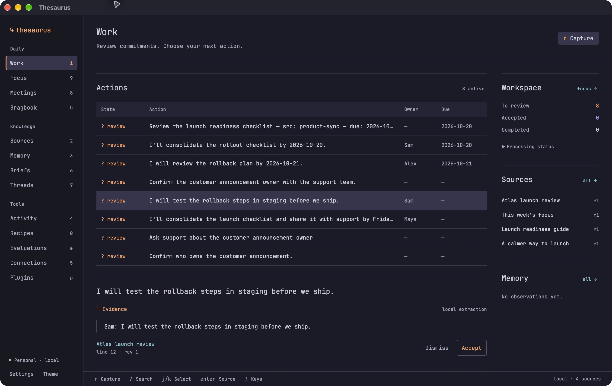
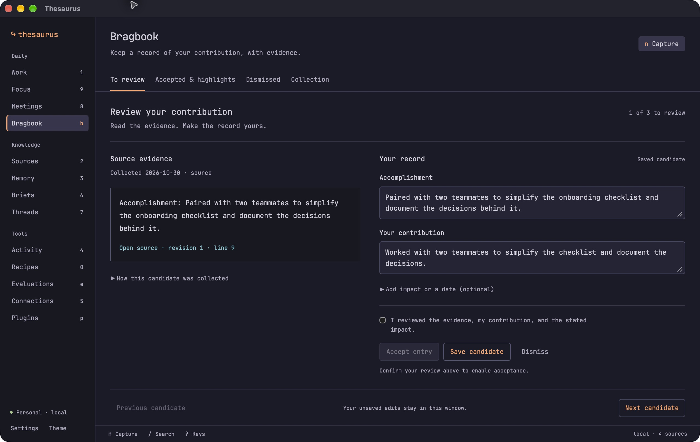
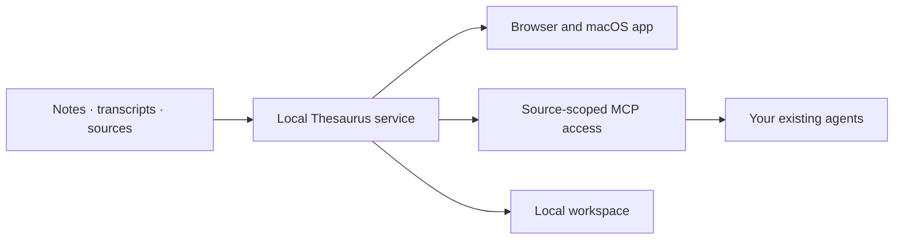

# Thesaurus

### Memory for your work

Thesaurus keeps notes, transcripts, and other work context in a local workspace. Search it yourself, review suggested actions and accomplishments, or share selected sources with your AI agents.

[Get started](#get-started) · [Connect an agent](#connect-an-agent) · [How it works](#how-it-works) · [Contributing](CONTRIBUTING.md)

> **Early alpha.** Thesaurus is under active development. The first desktop target is macOS on Apple Silicon; the local app is not yet notarized for public distribution. See [release readiness](docs/release-readiness.md) for what has and has not been verified.

## What you can do

Meetings and projects leave a trail of decisions, notes, and commitments across different tools. Thesaurus brings those sources into one workspace where you can:

- Import transcripts, notes, and other source material, with revisions that retain the original evidence.
- Search locally and assemble a bounded set of context for a task.
- Review suggested actions, project briefs, and accomplishments alongside their cited sources.
- Keep track of project threads and checkpoints, and grant agents access to selected sources.

[Bragbook](docs/bragbook.md) is a built-in plugin for collecting possible accomplishments from your sources. You can review your contribution and export the highlights you accept.

## Screenshots

These screenshots use fictional sample data, including the [Atlas launch review](fixtures/readme-launch-review.md).

**Work:** Review extracted actions and the source behind a selected item.



**Bragbook:** Review an accomplishment alongside its source and edit your contribution.



## How it works



A Rust service manages the workspace and its SQLite database. The browser and macOS app use the same interface and service. Connected agents use separate grants that you can revoke. Local capture, search, and deterministic extraction work without a configured model account. Model use and external sharing are controlled separately.

**Local-first does not mean encrypted or offline-only.** Workspace data is not currently encrypted at the application layer. External agents, model connections, and executable plugins can access or transmit data when configured and authorized. Install plugins you trust, protect your workspace and backups, and read the [security policy](SECURITY.md) before using sensitive material.

## Get started

### Build and run from source

The following path targets macOS on Apple Silicon. Install Xcode Command Line Tools, Git, and a shell. The bootstrap script installs the pinned Rust and web tools under `.tools/` without changing your shell profile.

```sh
git clone https://github.com/kdemoya/thesaurus.git
cd thesaurus
./scripts/bootstrap.sh
./scripts/build-web.sh --release --locked
./scripts/cargo.sh build --locked -p thesaurus
export THESAURUS_DATA_DIR="$PWD/.local/dev"
target/debug/thesaurus init
target/debug/thesaurus serve
```

Keep the service running. In another terminal, from the repository root, open an authenticated browser session:

```sh
export THESAURUS_DATA_DIR="$PWD/.local/dev"
target/debug/thesaurus open
```

Choose **Explore a sample workspace** to try synthetic data, or **Add context** to bring in a transcript or note. Pairing links are single-use and expire after two minutes; sessions end after 24 hours or a service restart. Run `open` again to pair.

You can also import and search a file from the CLI:

```sh
target/debug/thesaurus import /absolute/path/meeting.md --kind transcript
target/debug/thesaurus search "launch"
target/debug/thesaurus context "launch" --budget 8000
```

Stop the service with `Ctrl-C`; the workspace remains on disk. Audio recording, OCR, and transcription use additional helpers; see [development](docs/development.md) and [transcription options](docs/transcription-options.md).

### Build the macOS app

The desktop build also needs Node/npm, Python, and the macOS build tools. It bundles the same UI assets used by the browser, plus the local service and native helpers.

```sh
./scripts/build-desktop.sh --debug --local
```

The app is built at `target/debug/bundle/macos/Thesaurus.app`. See [development](docs/development.md) for running it against a chosen workspace and [macOS alpha builds](docs/macos-alpha-build.md) for packaging. Local builds are for review: Developer ID signing, notarization, and fresh-Mac acceptance remain outstanding for public distribution.

## Connect an agent

Find source IDs in **Shared memory** or with `thesaurus status`, then create a grant for your agent:

```sh
target/debug/thesaurus agent add my-agent --source SOURCE_ID --write
```

The command writes a private grant file and prints an MCP configuration snippet for your agent. Omit `--write` for read-only access. External agents can retrieve only granted sources that also permit external sharing; use `--local-agent` only for an agent that processes entirely on your device. Revoke a grant with `thesaurus agent revoke GRANT_ID`.

Your agent keeps its own authentication and model choices. Thesaurus does not copy credentials from other agents. See [development](docs/development.md), [source controls](docs/source-controls.md), and the [ACP integration guide](docs/acp-integration.md).

## Explore the project

| Guide | What you'll find |
| --- | --- |
| [Bragbook](docs/bragbook.md) | Collect, review, and export evidence-backed accomplishments |
| [Living briefs](docs/living-briefs.md) · [Work continuity](docs/work-continuity.md) | Project context, threads, checkpoints, and meeting preparation |
| [Project focus](docs/project-focus.md) | Priorities and waiting-for reviews |
| [Plugins](docs/plugins.md) | Plugin contracts, permissions, and authoring |
| [Meeting companion](docs/meeting-companion.md) · [Transcription](docs/transcription-options.md) | Recording and transcription options and their acceptance limits |
| [Development](docs/development.md) · [Release readiness](docs/release-readiness.md) | Architecture, build commands, verification, and open release work |

Recording on real devices, installation on a fresh Mac, backup and restore, and public distribution still need acceptance testing. Direct Slack synchronization, filesystem watchers, semantic/vector search, and a hosted multi-user service are not part of the current implementation. See [release readiness](docs/release-readiness.md) and [backlog verification](docs/backlog-verification.md) for details.

## Contributing and security

Contributions are welcome. Read [CONTRIBUTING.md](CONTRIBUTING.md) for development checks and use synthetic examples in issues and pull requests. Report vulnerabilities privately using the process in [SECURITY.md](SECURITY.md).

Thesaurus is open source under the [MIT license](LICENSE). [Third-party components](THIRD_PARTY.md) retain their own licenses.
