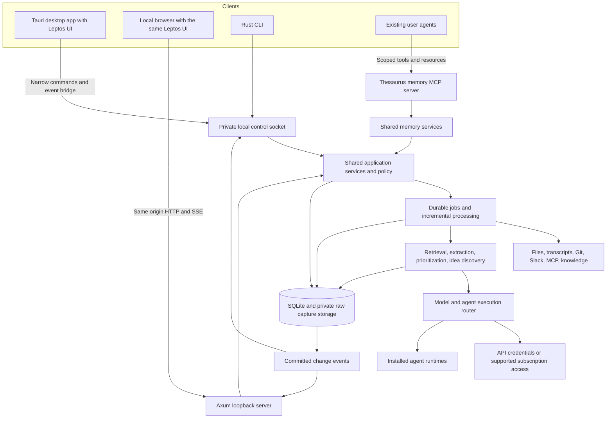

# Thesaurus Implementation Plan

Plan date: October 16, 2026.

Implementation update: the initial local service, Leptos/Tauri clients, capture and review workflow, optional model adapters, and scoped MCP memory are now implemented. See [initial implementation status](initial-implementation.md) for working scope and limits, and [development](development.md) for build commands. The phases below remain the broader delivery roadmap.

Build a local work assistant around one persistent Rust service. The service ingests work context, stores source revisions and evidence, maintains retrieval indexes, and generates suggestions. A Tauri desktop app and a local browser interface share the same UI and service state. Existing agents can query and contribute to the same work memory, and the assistant can route processing through the user's supported agent subscriptions or API credentials.

The first useful release should turn an imported meeting transcript and existing work notes into reviewable actions and priorities, each linked to its source. Slack, company knowledge, repositories, and multiple MCP connections then enrich that same processing pipeline.

The [similar-project research](similar-projects.md) and [feature backlog](feature-backlog.md) add source-linked product ideas. P0 entries map to the existing direction; new extensions remain candidates until selected for a phase. The delivery estimates below do not include the entire research backlog.

## Scope and decisions

Confirmed by the user:

- Local desktop and local browser access come first.
- The native app can use a shared web interface.
- Use Rust as much as practical.
- Integrate with the user's existing agents and reuse supported model subscriptions and API credentials.
- Expose a shared memory layer so different agents can access work context.
- Support user extensions through plugins and lifecycle hooks; make native product functionality first-party plugin providers as well. See [F44 scope](feature-backlog.md#plugins-and-native-capabilities).
- Provide guided onboarding for model/agent connections and other feature prerequisites, with a pixel-dot visual direction inspired by the user's [personal site](https://kdemoya.github.io/). See [F45 scope](feature-backlog.md#f45-onboarding-flow-and-visual-direction).

Proposed defaults:

- macOS is the first desktop release; core interfaces avoid macOS assumptions.
- One local user and one workspace initially, with workspace IDs in persisted records.
- Rust frontend using Leptos client-side rendering, packaged by Tauri for desktop and served as static assets for browsers.
- SQLite is authoritative for Thesaurus records, queues, and preferences. External sources remain authoritative for their own content.
- Existing transcripts and streaming text are the initial meeting inputs. Audio capture and transcription follow separately.
- Model endpoints are configurable. Connecting a source and permitting its content to leave the machine are separate settings.
- MCP is the primary interface for agent memory access; local HTTP and CLI interfaces expose the same application services.
- Model access and agent integration are independent connections. An agent can read authorized memory without granting Thesaurus access to its model account.

Hosted access, multi-user collaboration, cross-device synchronization and autonomous repository implementation follow the local MVP. Plugin extensibility and native capability modularity are an explicit follow-on workstream (F44); a stable public SDK and marketplace follow the initial local plugin host.

## Recommended technology

| Area | Choice | Reason and constraint |
| --- | --- | --- |
| Desktop | Tauri 2 | Native application lifecycle and OS integration around a shared web UI. The content renders in the system WebView. |
| Shared UI | Leptos CSR, WebAssembly, HTML/CSS, Trunk | Keeps interface logic in Rust and produces static assets for both clients. A small JavaScript bridge may be needed for desktop APIs. |
| Runtime and HTTP | Tokio, Axum, Tower | Async connectors, bounded worker tasks, HTTP commands, and server-sent events. |
| Persistence | SQLite with SQLx migrations | Local transactional records and job queues without a separate database service. Use WAL, foreign keys, bounded writes, and a busy timeout. |
| Retrieval | SQLite FTS5 plus metadata routing | Begin with lexical search and source/project/person/time filters. Measure omissions before introducing vectors. |
| MCP | Official Rust SDK, `rmcp` | Client sessions for external sources and a server interface for shared memory, with stdio and Streamable HTTP compatibility checks. |
| Models and agent runtimes | `reqwest`, `serde`, Rust process/protocol adapters | Direct API calls or supported installed-agent interfaces, with structured outputs and explicit billing mode. Keep orchestration in Rust. |
| Local sources | `notify`, Markdown/frontmatter parsing, bounded Git commands | File watching plus reconciliation; exact repository revision provenance. |
| Operations | `tracing`, TOML config, OS credential storage | Redacted diagnostics, validated configuration, and credentials outside the UI and repository. |

Tauri documents its [Rust core and WebView model](https://v2.tauri.app/concept/process-model/) and a [Leptos integration](https://v2.tauri.app/start/frontend/leptos/). Leptos documents [static CSR deployment](https://book.leptos.dev/deployment/csr.html). The Tauri Leptos example explicitly targets an older Leptos release, so the first milestone must establish a compatible current toolchain rather than copying its version pins.

[Axum supports SSE](https://docs.rs/axum/latest/axum/response/sse/), and [SQLx exposes SQLite connection options](https://docs.rs/sqlx/latest/sqlx/sqlite/struct.SqliteConnectOptions.html). [SQLite WAL](https://www.sqlite.org/wal.html) supports concurrent readers with one writer at a time; keep database transactions short and run inference and network calls outside them. [FTS5](https://www.sqlite.org/fts5.html) supplies the initial text index.

The [official MCP Rust SDK](https://github.com/modelcontextprotocol/rust-sdk) provides client transports for stdio and Streamable HTTP. Pin a published release after checking the actual target servers, authentication, and negotiated protocol versions.

### Alternatives

| Option | Assessment |
| --- | --- |
| Tauri with Leptos | Recommended balance of Rust ownership, shared UI, and explicit desktop integration. Validate WebView behavior, accessibility, and bridge ergonomics early. |
| Dioxus desktop and web | Credible alternative for a shared Rust UI. Its documented [desktop renderer uses a WebView](https://dioxuslabs.com/learn/0.7/guides/platforms/desktop/). Reconsider if the Leptos bridge makes routine desktop interactions awkward. |
| Tauri with TypeScript UI | Practical fallback if Rust UI tooling blocks product work; retains the Rust service and desktop shell but adds another application language. |

The initial UI milestone should prove source viewing, keyboard navigation, event updates, and desktop commands before substantial interface investment.

## Runtime architecture

### Onboarding and readiness (F45)

Add a shared, resumable onboarding flow around existing connection/configuration services. Start with the user's goal, connect their primary installed-agent/API/local model route where needed, configure the selected capability, and offer a first useful sample or explicit real action. Expose readiness and targeted repair in Settings and at feature entry points. Recording with local transcription can be ready without a reasoning model; once configured, starting recording remains immediate and meeting details follow afterward.

Persist progress and chosen connections in the service-backed workspace configuration, with host-specific OS permission/readiness checks and invalidation when relevant configuration changes. Distinguish saved configuration, static validation, authentication checks and a successful actual invocation. Use the existing usage-preview/approval and credential-reference paths for real model checks. Do not mark unperformed checks complete.

Use F44-compatible prerequisite, configuration and readiness contracts for first-party setup, then accept plugin-contributed steps through the shared renderer. F45 builds on current connection/configuration services and the plugin host's capability status; its initial guided flow is delivered separately from F44, while full inline plugin and connector configuration remains follow-up work. Native providers perform platform permission requests; the browser presents the connected host's readiness and repair actions. Setup steps are declarative, and skipping a step never changes the underlying readiness result.

F44 now supplies that foundation: optional manifest setup steps, configuration/operation/dependency/capability prerequisites, typed repair targets, an explicit read-only `readiness` invocation through the durable queue, and the shared Plugin settings renderer. Check results expire and bind to configuration and host state. The compiled file-workflow example checks its input before import; first-party capture and notification providers expose passive authorization checks through the same contracts. F45 now provides welcome/progress/primary selection, guided audio and scoped memory preparation, using a reusable large dot-matrix alphabet. Full connector-specific and inline plugin configuration remains follow-up work.

The visual direction comes from the user's dot-grid/particle site: a small Thesaurus-specific dot form, monospaced status/controls, deliberate spacing and brief state-driven assembly transitions. Use current theme tokens, a reduced-motion/static variant and accessible HTML forms that work independently of animation. The [F45 backlog](feature-backlog.md#f45-onboarding-flow-and-visual-direction) defines the proposed steps, references and acceptance criteria. The initial flow and large dotted number/letter direction are now implemented; see [onboarding](onboarding.md) for scope and pending runtime acceptance.

### Service and clients



### One owner of background work

`thesaurusd` owns storage, connectors, processing jobs, schedules, credentials, and the loopback listener. Both clients can close without cancelling ingestion. macOS login service installation is a user setting; during development the daemon can run in the foreground.

The daemon also owns shared memory and execution routing. Launching an MCP stdio adapter for each agent creates lightweight clients of this daemon; it does not create another database or ingestion worker.

The desktop app discovers the daemon through a private instance descriptor and control socket. A single-instance lock prevents a second daemon from starting duplicate connectors. Startup checks protocol and build compatibility before attaching; upgrade handoff drains workers before migration. Explicitly distinguish closing a window, quitting the desktop client, pausing capture, and stopping the background service.

Package the daemon with the desktop application and version them together. Browser-only operation uses the same daemon binary. Store runtime files in platform application data locations, with a private parent directory and owner-only credentials/socket permissions. Neither client opens SQLite directly.

### Shared presentation and contracts

Compile the same Leptos components into browser and desktop assets. A small client transport abstraction maps typed commands to browser HTTP or the Tauri bridge; the bridge forwards to the daemon's control socket. Both paths invoke the same application services and authorization rules.

Start with a versioned `/api/v1` surface for source management, captures, documents, meetings, search, tasks, suggestions, feedback, and approvals. Share serializable request/response types through a crate that compiles to WASM without Tokio, filesystem, database, or credential dependencies. Use record versions for conflicting mutations and idempotency keys for retried commands.

Browser updates use SSE; user commands use HTTP. Transcript producers submit text segments separately, so SSE is sufficient for the first interface. Add WebSockets only if audio or a proven bidirectional streaming requirement needs them.

Persist event sequence numbers with committed changes. Clients resume with their last event ID and refetch affected views. If an event has expired from retention, send a reset event and obtain a fresh snapshot with a new watermark. Bounded per-client queues prevent a slow view from blocking ingestion.

### Local access

Serve the browser UI and API from the same loopback origin. Opening the browser from the desktop app or CLI provides a short-lived pairing code in the URL fragment, exchanged once for a local session and then removed. Protect content reads as well as writes; use HttpOnly, SameSite cookies, a CSRF token for mutations, strict Host/Origin checks, and no permissive CORS.

The desktop UI loads bundled assets and receives narrowly scoped Tauri capabilities. Credentials stay in the Rust service and OS credential store. Do not expose arbitrary filesystem, shell, or unrestricted HTTP commands to the WebView.

## Existing agents and model access

### Two independent integration directions

An existing agent can use Thesaurus memory while continuing to own its own conversations, model choice, tools, and billing. Separately, Thesaurus can delegate an analysis job to a supported agent runtime or make a model request with an API credential the user selects. Either connection should work independently.

Initial integration targets are Codex and Claude Code, with MCP-compatible agents able to consume memory without a custom runtime adapter. Add Hermes/Herdr session handoffs after confirming their installed protocol contracts. Detection should report available installations and supported features without reading credential contents or changing the user's setup.

Evaluate [Agent Client Protocol](https://agentclientprotocol.com/get-started/introduction) as a common runtime integration, informed by [Goose's ACP adapters](https://goose-docs.ai/docs/guides/acp-providers/). ACP connects the host to an agent; MCP supplies tools and work context. Its [Rust library](https://agentclientprotocol.com/libraries/rust) fits the language direction, while adapter-specific authentication, dependencies, permissions, and session features still need validation. Retain provider-specific interfaces where they expose required capabilities that an ACP adapter lacks.

Offer a connection preview showing the executable or endpoint, account/profile where available, enabled operations, memory scope, model/billing mode, and configuration changes. Generate an additive client configuration snippet by default. Applying it is an explicit setup action that preserves unrelated configuration and offers a backup. Do not overwrite agent instructions, plugins, existing MCP servers, or active sessions.

### Access modes

| Mode | Integration | Billing and lifecycle |
| --- | --- | --- |
| Existing API credentials | User-selected environment variable reference, OS credential reference, approved provider profile, or an explicitly added key. | Use the selected API account's billing, model access, quotas, and data policy. Store references where possible. |
| Installed agent runtime | Invoke a documented app-server, structured CLI, or SDK protocol through a Rust adapter. | The runtime manages its supported authentication. Record its billing mode and limits when reported; do not extract or replay its private login tokens. |
| Provider-supported subscription authorization | Use the provider's documented authorization flow for third-party or local applications where eligible. | Account/plan eligibility, granted scopes, deployment type, and provider terms determine access. A new authorization may be needed even if the user already has a subscription. |
| Local model endpoint | Connect to a user-selected local endpoint with declared capabilities. | Use local compute; report unavailable features and measured latency. |

API credentials can be reused through explicit references without scanning unrelated dotfiles or copying another app's secret store. Source credentials, Thesaurus memory grants, model credentials, and agent session authentication have separate audiences and lifecycles.

Provider documentation checked October 16, 2026:

- **OpenAI:** [Codex supports ChatGPT sign-in and API-key access](https://learn.chatgpt.com/docs/auth). Its [app-server authentication guidance](https://learn.chatgpt.com/docs/app-server#auth-endpoints) recommends Sign in with ChatGPT for local/open-source integrations and excludes commercial/hosted use of app-server authentication. New subscription integration should follow the [documented registration flow](https://developers.openai.com/siwc/token-sharing-open-source/sign-in), subject to eligibility and [preview limits](https://developers.openai.com/siwc/token-sharing-open-source/preview-limitations). Choose the applicable path once distribution is defined.
- **Anthropic:** [Claude Code supports programmatic structured output](https://code.claude.com/docs/en/headless). Its [current plan guidance](https://support.claude.com/en/articles/15036540-use-the-claude-agent-sdk-with-your-claude-plan) states that Agent SDK, `claude -p`, and third-party app use can draw from subscription limits. Verify the selected plan, runtime version, and supported authorization before enabling a connection.

These are provider-specific integrations, not a promise that every subscription authorizes arbitrary model API calls. Recheck support before implementation and release. Keep provider SDK dependencies optional: Rust can speak the app-server protocol or run a structured CLI without introducing Python into the main application.

### Workload routing and quota controls

Each connection advertises structured output, streaming, tools, context size, cancellation, session handoff, and available model information where supported. Route commitment extraction, priority review, idea discovery, and interactive handoffs by required capabilities, permitted data destinations, expected latency, user preference, and budget.

Give the user explicit choices such as “use my connected agent,” “use this API account,” or “use this local endpoint” for each workload. Reserve configured subscription capacity for the user's interactive work, bound unattended concurrency, and pause on exhaustion. Model catalogs are suggestions until access is verified; omit unreported quota figures and distinguish token counts, subscription allowance, and monetary cost.

Switching from a subscription or local connection to a paid API account requires an explicit fallback rule. A rate limit must not silently cause API charges. Persist connection ID, billing mode, session ID, input evidence, and safe usage summaries with every run.

For job delegation, send a bounded context bundle and task-specific tool permissions. Preserve repository instructions and the user's chosen runtime configuration within those limits. Observe progress, cancellation, and approval requests through documented protocols. Treat a handoff into an existing interactive session as a distinct user action; otherwise use a named isolated session. A memory read never starts a model job by itself.

## Shared work memory

### One memory service with several interfaces

Expose the daemon's existing knowledge and task services as shared memory. Agents retrieve source evidence, curated facts, active work, and past decisions through a consistent contract. The memory API can answer search and record-read requests without any model subscription or API key.

| Interface | Role | Initial scope |
| --- | --- | --- |
| MCP server | Main compatibility layer for existing agent clients. | Search/read/context tools, stable resources, and controlled observation contributions. |
| Local HTTP API | Custom integrations and application clients. | The same operations and policy, with versioned schemas. |
| CLI | Shell-based agents and user inspection. | JSON search, record reads, context bundles, and proposed observations. |
| Markdown/JSON export | Portable snapshots for tools without a live integration. | Explicitly selected, dated content with citations and a stated staleness limit. |

Recommend MCP plus HTTP/CLI from the first useful release. Exports provide compatibility but require regeneration. Direct SQLite access would bypass policy, revision checks, and auditing; all clients use the memory service. A separate memory database or vector service is unnecessary for the initial release.

Thesaurus has two MCP roles: it consumes external source servers and exposes its own memory server. Keep their configuration, credentials, and health separate. MCP client sampling may be evaluated later as an optional execution adapter; memory compatibility must not depend on a host offering sampling or granting unattended model access.

### Memory types and contribution rules

| Type | Examples | Authority |
| --- | --- | --- |
| Source evidence | Transcript excerpts, knowledge revisions, Slack messages, repository references. | Source system and captured revision. |
| Curated facts and preferences | Confirmed ownership, project context, user working preferences. | User or a reviewed source-backed update. |
| Work state | Tasks, commitments, dependencies, priorities, and decision status. | Accepted records with versions and user edits. |
| Agent observations | Session summaries, hypotheses, discoveries, and proposed tasks. | Attributed proposals until validated or accepted. |
| Session context | Handoffs and temporary working notes. | Named agent/session, with private or explicitly shared scope and optional expiry. |

An agent contribution records the authenticated integration ID, session, timestamp, evidence references, visibility, processing destination restrictions, and idempotency key. A claimed agent name is display metadata, not authentication. Contributions without supporting sources remain labeled observations. Agents cannot promote their own hypotheses into canonical source facts or rewrite user decisions through a generic memory append operation.

Track derivation links and content hashes to avoid treating an agent summary as independent corroboration of the evidence that produced it. Exclude repeated self-generated material from ingestion triggers unless it adds a new accepted fact or source revision. Concurrent edits require an expected record version; retained corrections supersede earlier observations rather than silently erasing their history.

### Proposed MCP surface

| Operation | Purpose |
| --- | --- |
| `memory_search` | Search authorized evidence and memories by text, project, person, source, kind, and time. Return bounded excerpts, revision references, freshness, and continuation cursors. |
| `memory_get` | Read a particular record or cited document revision with structured provenance. |
| `context_build` | Assemble a bounded context bundle for a question or task, including active commitments, relevant evidence, unresolved conflicts, and a snapshot watermark. |
| `memory_append_observation` | Contribute an attributed observation with sources, scope, session, and a deduplication key. |
| `task_propose` | Propose a source-backed task for normal user review. |
| `handoff_create` | Publish a context bundle and session summary for another authorized agent. This does not start that agent. |

Start with the first four operations in Phase 1. Later task and handoff operations call the normal task/review services. Keep destructive actions and external delivery outside a generic memory tool.

Expose stable resource URIs such as `thesaurus://documents/{id}/revisions/{revision}` and `thesaurus://memories/{id}` where clients support resources. Tools remain sufficient for clients that use only tool calls. [MCP resources](https://modelcontextprotocol.io/specification/latest/server/resources) support discovery and reads; use notifications or subscriptions only after negotiating the relevant client capabilities. Fetching a cited URI always rechecks access, and clients can compare watermarks even when push updates are unavailable.

### Identity and access

Issue a separate revocable grant for each agent integration. Scope it by workspace, source/project selection, read/write operations, visibility, expiry, and permitted processing destination. A local agent that sends prompts to a cloud model needs an appropriate disclosure grant before receiving restricted content; after delivery Thesaurus cannot enforce the agent's downstream retention or tools.

Use `thesaurus mcp serve` as a thin stdio proxy to the daemon for local clients. Provision its grant through a protected local credential reference, preserving one daemon and one database. Offer Streamable HTTP for clients that support authenticated local HTTP, following the applicable [MCP authorization specification](https://modelcontextprotocol.io/specification/latest/basic/authorization). Hosted-only agents need a separately designed remote connection; they cannot directly reach a user's loopback listener.

Never infer access from MCP `clientInfo`, accept model-provider credentials as memory grants, or pass an inbound memory token through to a source API. Apply policy before search so unauthorized material cannot leak through snippets, counts, summaries, or context bundles. Log record access and contributions without logging secret values or unrestricted bodies. Revocation stops new reads; source deletion/forgetting invalidates derived memory, exports remain explicitly identified snapshots.

## Data and processing model

### Persisted records

| Record | Essential fields and behavior |
| --- | --- |
| Source | Workspace, connector kind, instance ID, config, credential reference, permissions, health, checkpoint, last successful sync. |
| Document and revision | Provider-scoped external ID, canonical URI, source revision/content hash, observed and source times, status, sensitivity and permitted processing destinations. |
| Capture and segment | Capture ID, source event ID, sequence, speaker reference, start/end time, provisional/final status, revision, raw storage reference. |
| Chunk and evidence | Document revision, locator such as transcript interval/Markdown section/Slack message/Git blob, exact text hash, derivation links. |
| Person, project, relation | Stable internal IDs, explicit external identities and aliases, evidence, validity dates; unresolved identities remain visible. |
| Task and commitment | Owner or unresolved owner, due date, status, user edits, linked source claims, external mapping, optimistic version. |
| Suggestion | Kind, supporting evidence, explanation, uncertainty, rank factors, generated time, source watermark, suppression key, state. |
| Priority topic and feedback | Explicit focus, archive state, accepted/dismissed/snoozed/corrected feedback and optional reason. |
| Job and model run | Dedupe key, input revisions, state, lease, attempt, next run time, prompt/model version, usage and safe error category. |
| Agent integration and grant | Runtime/client identity, protocol capabilities, allowed memory scope, destination policy, credential reference, expiry, and revocation. |
| Execution connection | API/runtime/subscription/local mode, account/profile reference, reported model capabilities, billing mode, routing rules, and budgets. |
| Memory contribution and handoff | Kind, authenticated contributor and session, evidence and derivation links, visibility, proposal/accepted/superseded state, expiry, and expected version. |
| Approval and audit event | Exact proposed action and target, payload digest, source versions, expiry, decision, execution state and result. |

Separate source facts, model inferences, and user decisions. An extracted candidate becomes an accepted task through user review; later analysis cannot silently overwrite the user's owner or due date. Evidence records must locate a particular source revision, not just a mutable document URL.

Memory views reuse these records rather than duplicate the source corpus. Apply source access and processing restrictions to derived summaries and handoffs; an agent contribution cannot widen the permissions of its evidence.

Use relational links for people, projects, decisions, tasks, and documents initially. Add a graph database only if measured queries require it.

### Ingestion lifecycle

1. Receive a connector event or reconciliation result with a stable external identity.
2. Normalize source metadata and content. Detect unchanged revisions before scheduling analysis.
3. Persist the new revision, checkpoint, and downstream jobs transactionally. Advance a cursor only after the corresponding data is durable.
4. Store raw captures in private files and normalized records in SQLite. Use staged writes, hashes, and recovery reconciliation across filesystem/database boundaries.
5. Chunk and index the revision, then run applicable extractors with bounded retrieved context.
6. Validate structured results and evidence locators; persist derived records with their input revisions.
7. Recompute affected suggestions and publish committed change events.

File notifications are hints. Periodic reconciliation detects dropped events, offline changes, edits, and deletions. Preserve source identity when filenames change where the source supports it. Dedupe by connector instance and external ID; use content hashes for revision reuse without merging unrelated documents that happen to share text.

Workers use durable leases with heartbeats, backoff, cancellation, and explicit blocked/failed states. Processing is at least once, with idempotent writes. Network calls and model runs never hold a database transaction. Separate per-source and model concurrency limits prevent a slow connector from starving captures.

### Continuous meeting assistance

Accept complete transcript imports and ordered text segment updates through one capture interface. Track segment corrections and reconnect sequences. Analyze finalized segments or stable windows after a short debounce; provisional observations may appear in the live view, while durable commitments wait for stable evidence.

Retrieve active work and relevant knowledge for each window. Extract candidate actions, owners, dates, decisions, unanswered questions, and contradictions. Reconcile the same candidate as a conversation develops so a corrected due date updates one suggestion. Mark superseded observations and run a final reconciliation at meeting end.

Initial performance targets, to measure on a representative local corpus:

- Persist an incoming text event within 250 ms at p95, excluding upstream delivery.
- Show committed local changes in both clients within one second at p95.
- Produce a candidate within ten seconds of a finalized window at p95 when the selected model can meet that budget.
- Remain responsive while offline or while inference is delayed; report queue age and source freshness.

These are acceptance targets, not current benchmarks. API latency, upstream limits, source polling intervals, and model availability determine the actual source-to-suggestion delay.

### Retrieval and suggestions

Start with FTS5 retrieval filtered by source access, workspace, people, project, time, and active priority topics. Rank relevant evidence by lexical match, source authority, recency, and relation to active work. Include source freshness and conflicting evidence in model context. If nothing supports a suggestion, abstain.

Use separate jobs for commitment extraction, priority review, idea discovery, and daily briefings. Extraction runs on changed material. Priority review also reacts to due dates, blocked dependencies, user feedback, and new commitments. Idea discovery runs after meaningful changes or on a bounded schedule, rather than once per transcript token.

Keep prioritization explainable: user pinning, deadlines, blockers, explicit commitments, and topic alignment are visible factors. Models can propose relevance and effort; deterministic rules and user preferences govern ordering and notifications. Store uncertainty as evidence quality and unresolved fields before claiming a calibrated numerical confidence.

Every suggestion offers its rationale, sources, freshness, and accept/dismiss/snooze/correct controls. Stable suppression keys prevent repeated rejected ideas. Default to an in-app feed, with optional desktop notifications for high-value time-sensitive items, quiet hours, and a daily cap.

Create a small curated, synthetic or explicitly selected evaluation corpus with expected commitments, ownership ambiguities, conflicts, and useful retrieval results. Compare extraction precision/recall, citation validity, ranking usefulness, duplicate rate, latency, and model cost. Introduce embeddings only after lexical retrieval misses relevant evidence on this corpus.

## Connector strategy

Connectors declare capabilities such as document sync, live transcript input, resource reads, tool calls, and external mutation. They expose configuration validation, discovery, health, incremental sync, optional subscriptions, cancellation, and bounded results. Keep first-party connectors compiled into the service initially, behind plugin/provider contracts that can also support user-authored extensions. F44 supplies the plugin host; dynamic libraries and a stable public SDK remain separate decisions.

| Source | First implementation | Important behavior |
| --- | --- | --- |
| Existing Markdown vault | Read-only import and reconciliation for todos, meetings, people, topics, context digests, and drafts. | Preserve provenance and stable mappings; preview counts and conflicts before publication. |
| Meeting text | File import and authenticated segment API; bridge existing collectors when their contract is available. | Ordering, corrections, speaker uncertainty, finalization, and reconnect recovery. |
| Company knowledge | Local/repository Markdown first, including Garden-style frontmatter; approved MCP retrieval for connected documents. | Exact revision, freshness, access boundaries, deletion, and active-work change summaries. |
| Local repositories | Explicitly selected roots; tracked docs, repository metadata, selected code/symbol context, and bounded diffs. | Ignore generated/vendor files and secrets; avoid indexing every checkout or executing repository hooks. |
| MCP servers | Multiple configured stdio/Streamable HTTP clients using `rmcp`; explicitly selected resources/tools. | Credential isolation, negotiated capabilities, reconnects, pagination, timeouts, approved tool scope, and per-server quotas. |
| Slack | One explicit workspace and selected channels, incremental history/thread retrieval; event delivery where app permissions support it. | Preserve thread context, message IDs and permalinks, edits/deletions, access changes, rate limits, and backfill checkpoints. |
| Other web links | Bounded fetch/extraction behind an allowlist and URL policy. | Redirect/DNS checks, private-network restrictions, download limits, and extraction gaps. |

MCP is a protocol for interacting with servers; a server may offer tools without a continuous content feed. Use direct source APIs for reliable synchronization when needed and MCP for targeted retrieval or operations. Report discovered capability separately from successful authenticated execution. Do not trust a tool's self-declared safety annotations as authorization.

For Slack, confirm the workspace's allowed installation and token model before estimating backfill. The [current history method documentation](https://docs.slack.dev/reference/methods/conversations.history/) distinguishes access by token and scopes, applies different rate tiers to internal and commercially distributed applications, and requires honoring `Retry-After`. Avoid assuming identical limits across deployments. A local app should use an approved outbound event connection or polling rather than require a public webhook.

### Plugins and lifecycle hooks (F44)

Keep business state in the headless Rust service and implement native functionality through first-party capability plugins. UI-bound window management and tray/popover providers run in the desktop host. Audio capture, OCR and credential providers can run in the service or a platform worker where their OS APIs permit it, preserving browser-controlled recording without requiring a desktop window. Notifications and shortcuts use the host appropriate to their platform API. Only native bootstrap/event-loop setup, the broker and plugin loading remain shell responsibilities. Both clients use the same capability interfaces.

Use a shared manifest/version/capability model with separate service and desktop hosts. Initially use statically linked Rust provider modules in the appropriate service/desktop host, with UI-bound APIs confined to the desktop main thread, and a versioned subprocess protocol for user-authored service plugins. Keep platform handles within their owning host. The protocol is language-neutral, with a Rust SDK as the preferred authoring path; it is not a public Rust dynamic-library ABI or an implied OS sandbox.

Separate command providers from asynchronous lifecycle subscribers. A recording provider must confirm actual readiness, but optional transcript processors and notification subscribers cannot block recording start or audio delivery. Publish hooks from committed state through a durable delivery queue, with stable event IDs, record revisions, per-plugin cursors, bounded retries and idempotent host commands. Treat shutdown callbacks as best effort and retain service-owned recovery.

Plugins use current source grants, model budgets and ordinary reviewed mutation/action paths. Changing a grant applies at delivery and content-fetch time. Loading/updating/disabling providers respects dependencies and active resource ownership; an audio provider cannot be unloaded beneath an active recording. The [F44 backlog](feature-backlog.md#plugins-and-native-capabilities) specifies the hook catalog and migration slices. Service and desktop providers, all six contribution kinds, reviewed model routing, scoped native requests, setup contracts and shared management are implemented. The [requirement audit](plugin-acceptance-audit.md) records completed local macOS/browser acceptance, including native capture/OCR, and [plugin documentation](plugins.md) describes the contracts and limits.

## Privacy and action policy

Apply processing policy before retrieval, model requests, tool calls, and UI responses. Source records carry permitted destinations so local storage does not imply permission to send content to a cloud model. Model adapters receive the minimum needed evidence; secrets are screened from logs, raw tool output, and persisted generated artifacts.

Imported text and tool results cannot alter system policy. Reading a source, deriving suggestions, writing a local task, sending a Slack message, changing a tracker, and running a coding agent are separate capabilities. External effects require review of the exact target and payload. Approval is invalidated when the bound action or relevant preconditions change.

For outbound effects, track pending, executing, completed, failed, and outcome-unknown states. Use provider idempotency where available; reconcile uncertain delivery instead of automatically retrying a message that may already have been sent.

Keep raw captures under a configurable retention policy, initially 30 days for compatibility. Distinguish “delete raw capture” from “forget source”: the former can retain a labeled derived digest; the latter removes derived chunks, search/vector entries, and invalidates supported suggestions. Treat source deletion and lost access explicitly rather than leaving stale evidence searchable indefinitely. Document backup retention and the limits of physical secure erasure on local disks.

Use private application directories, OS credential storage, and bounded redacted logs. SQLite is not encrypted by default; the MVP relies on OS account and disk protection. Evaluate database encryption if the deployment requires protection beyond that boundary. Back up the database and retained blobs consistently, using SQLite's backup mechanisms rather than copying only the live main file while WAL is active.

## Proposed repository layout

```text
apps/
  daemon/                 # thesaurusd: Axum, control socket, worker lifecycle
  cli/                    # setup, source/model/agent connections, memory, MCP proxy
  desktop/src-tauri/      # native shell, narrow bridge, OS integration
crates/
  contracts/              # versioned DTOs shared with WASM clients
  core/                   # domain services, policy, jobs, retrieval, analysis
  storage/                # SQLite repositories, migrations, raw blob lifecycle
  connectors/             # files, transcripts, Git, MCP, Slack, knowledge
  agents/                 # installed runtimes, model access, execution routing
  mcp-server/             # shared memory tools/resources, delegated to core services
  ui/                     # shared Leptos components and client transports
fixtures/                 # synthetic import and processing examples
docs/
```

Keep individual adapters and processing stages as modules until real complexity warrants more crates. Dependency direction: contracts stand alone; core uses contracts and defines storage/provider interfaces; storage, connectors, and agents implement those interfaces; MCP server routes invoke core services; the daemon composes them. The WASM UI depends on contracts and client transports, with server dependencies excluded.

## Delivery phases

Effort ranges assume one experienced engineer working mostly full time and access to the necessary source credentials. They are planning estimates; connector permissions and the completeness of legacy data can change them.

### Phase 0 Foundation and desktop proof

**Estimate: 4–6 working days.**

1. Create the Cargo workspace, pinned Rust toolchain, formatting/lint configuration, and minimal build automation.
2. Prove the same Leptos view in a browser and Tauri WebView, with one typed command and one event update from the daemon.
3. Add daemon singleton discovery, foreground lifecycle, versioned health, private application paths, and a minimal CLI.
4. Add SQLite migrations, a source record, configuration validation, and credential references.
5. Create synthetic legacy-format fixtures from surviving tests and document missing importer details. Locate a complete legacy source copy if available without modifying the inspected directories.
6. Prove one installed-agent or subscription connection and one API credential reference through the common execution contract. Check account eligibility without consuming an unapproved paid fallback.
   Compare ACP with the provider-specific path before choosing the first adapter; record supported cancellation, permissions, session, and MCP forwarding behavior.

**Exit:** One daemon serves both interfaces; restarting a client preserves state; no application dependency requires Python. Confirm the Rust UI choice here.

### Phase 1 Useful local assistant

**Estimate: 3–4 weeks after Phase 0.**

1. Implement Markdown and complete transcript ingestion with dry-run import manifests and stable mappings.
2. Implement raw/normalized storage, durable jobs, revision tracking, FTS5 search, source viewing, and evidence locators.
3. Add direct API and supported installed-agent execution adapters, explicit billing modes, routing/quotas, and structured commitment extraction with uncertain owners and due dates represented explicitly.
4. Build Now, Meetings, Sources, and Search views; support reviewing candidates, accepting tasks, completing tasks, and feedback.
5. Deliver SSE resume/reset behavior and validate crash/replay/idempotency boundaries with synthetic inputs.
6. Ship shared memory search/read/context/observation services through MCP stdio, HTTP, and CLI. Connect two existing agent clients with separate scoped grants and additive setup previews.

**Exit:** Import one meeting and existing notes, receive grounded candidate actions using the selected model connection, accept a task, and retain it after restart. Two independently connected agents retrieve the same authorized evidence; an attributed observation contributed by one is visible to the other only within its grant. Revocation and quota exhaustion behave predictably without silent paid fallback.

### Phase 2 Connected work context

**Estimate: 2–3 weeks.**

1. Add multiple MCP client sessions, explicit resource/tool selection, credential setup, and independent health states.
2. Add selected repository and company knowledge synchronization with commit provenance and relevant-change summaries.
3. Add Slack workspace/channel selection, bounded backfill, thread retrieval, rate-limit handling, and edit/delete reconciliation.
4. Connect people/project mappings across sources and re-evaluate suggestions when their evidence changes.
5. Add authenticated MCP HTTP compatibility, resource discovery, controlled task proposals, and context handoffs; verify existing agent tools/settings remain usable.

**Exit:** One suggestion can combine a meeting commitment, a Slack discussion, and a knowledge/repository reference with separate citations; one broken connector leaves other ingestion running.

### Phase 3 Continuous suggestions and discovery

**Estimate: 2–3 weeks.**

1. Add streaming text capture, provisional/final segment handling, incremental extraction, correction, and meeting-end reconciliation.
2. Add priority topics, task dependencies, explainable ranking, related-work discovery, and scheduled briefings.
3. Add durable dismissal/snooze behavior, quiet hours, notification controls, and per-job token/time/cost budgets.
   Apply those budgets across API and agent connections, with a reserve for interactive subscription use.
4. Replay the evaluation corpus; tune extraction, retrieval, and duplicate suppression before enabling broader notifications.

**Exit:** Revised transcript statements update existing suggestions; relevant work changes trigger useful recommendations with evidence, bounded latency, and predictable notification volume.

### Phase 4 Desktop release and operational readiness

**Estimate: 1–2 weeks, with basic desktop packaging started in Phase 0.**

1. Finish tray controls, login service settings, keychain flows, desktop notifications, pause/resume, and source setup guidance.
2. Add retention, forget-source propagation, backup/restore, migration recovery, and redacted diagnostics.
   Include memory grants, contribution provenance, model reconnection, and agent configuration removal in recovery/setup flows.
3. Package and sign/notarize a macOS build when signing credentials are available. Rehearse upgrade, rollback, and simultaneous client access.
4. Verify source policy, local sessions, permissions, crash recovery, evaluation quality, and a working day of normal usage.

**Exit:** Install on a clean macOS account, connect selected sources, use desktop or browser independently, upgrade safely, and restore a backup.

The first useful assistant, including existing-agent access and shared memory, is approximately 4–6 weeks from implementation start. The broader local MVP, including the listed integrations and continuous text assistance, is approximately 9–14 weeks. Live audio, autonomous coding, hosted deployment, and additional desktop platforms are separate workstreams. These ranges include basic Codex/Claude compatibility; adding more runtime-specific adapters extends scope.

## Legacy coexistence and migration

1. Inventory and back up selected data sources before importing. Never merge or reset the old source directories as part of initialization.
2. Import into a new workspace with a manifest recording source hashes, parser versions, mappings, conflicts, and failures. The import itself makes no model requests and executes no queued work.
3. Make repeated imports idempotent. Preserve legacy evidence references and resolve them through a mapping to new document revisions.
4. Keep legacy Markdown authoritative for imported records during coexistence. Show Thesaurus-local tasks separately; require an explicit handover before enabling writes back to a source.
5. Preview queued contexts, approvals, and implementation states individually. Old approvals become drafts and old agent sessions are not resumed automatically.
6. Rebuild disposable knowledge indexes from their canonical sources. Do not copy private credentials or machine-specific cron IDs into checked-in configuration.
7. At cutover, pause the corresponding old workers before enabling replacement ingestion/automation, verify counts and representative records, and retain rollback data.

## Validation gates

| Area | Required evidence before release |
| --- | --- |
| Ingestion | Duplicate and out-of-order events, cursor replay, crash recovery, transcript correction, source edit/delete, and failed connector isolation. |
| Storage | Transactional claims, expired lease recovery, no duplicate derived records, coherent blob recovery, migration rollback path, and backup restore. |
| Suggestions | Valid evidence locators, unresolved identity handling, user edits preserved, expired evidence invalidated, stable suppression, and useful evaluation results. |
| Clients | Identical state through desktop and browser, event reconnect/reset, stale version conflicts, keyboard operation, and usable source excerpts. |
| Agent compatibility | Two existing agents can connect without losing their other tools/settings; structured execution, cancellation, user approval, and reconnect behavior match each adapter's declared capabilities. |
| Model access | Correct account and billing mode, supported subscription authorization, expired credential recovery, quota pause, interactive reserve, and no paid fallback without a configured rule. |
| Shared memory | Equivalent results through MCP/API/CLI, citations retained, scoped reads before ranking, attributed/idempotent writes, no self-corroboration loops, version conflicts, revocation, and deletion propagation. |
| Policy | Unauthorized local reads/writes rejected; source text cannot grant capabilities; restricted content excluded from outbound model context; approvals bind exact actions. |
| Operations | Clean install, singleton behavior, client closure with daemon running, pause/resume, shutdown during processing, redacted diagnostics, and measured latency/cost. |

The planning work uses static inspection only. These gates belong to implementation; the incomplete legacy checkout is not a passing compatibility baseline.

## Follow-on work

After the local MVP, add optional audio capture/transcription through a platform boundary, then approval-driven external actions and planning agents. System audio, microphone permissions, and some desktop APIs may require a small Swift or other native bridge; a Rust orchestrator can still own their lifecycle.

Autonomous coding should have its own design and review milestone, preserving the existing worktree provenance, explicit permissions, recovery, and approval behavior. Hosted operation requires authenticated remote access, account isolation, remote workers/storage, credential management, and a local connector agent for private repositories and capture. Sharing contracts now helps that evolution; exposing the loopback daemon publicly is not a deployment plan.

During Phase 0, select the first installed agent/account to connect and establish whether distribution is personal, open source, or commercial so provider authorization follows the applicable supported path. Before Phase 2, choose the concrete source MCP servers, Slack installation/token model, company knowledge roots, and model/data permissions. Before live capture, identify the collector's available transcript contract. These decisions can proceed after the foundation starts.
